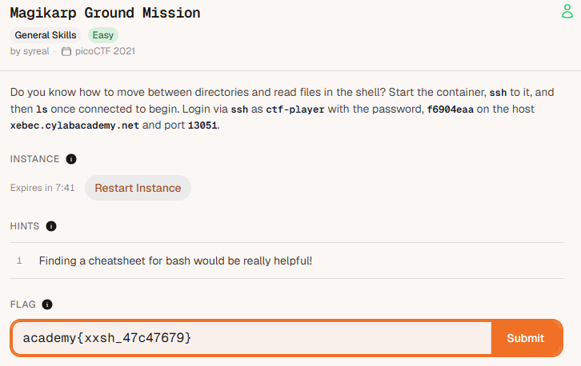
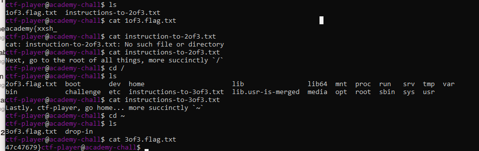

# 🚩 Challenge: [Magikarp Ground Mission]

## 📝 Challenge Description
> Paste the exact description text or hints provided by picoCTF here.

Do you know how to move between directories and read files in the shell? Start the container, ssh to it, and then ls once connected to begin. Login via ssh as ctf-player with the password, f6904eaa on the host chatelaine.cylabacademy.net and port 13051.

Instance
Expires in 08:06
Hints
1. Finding a cheatsheet for bash would be really helpful!

### Code / Terminal Snippets

1. ssh ctf-player@xebec.cylabacademy.net 13051
2. 

---

## 🚀 Exploitation / Solution Path
Detail your step-by-step breakdown to get the flag:
1. firsty connect to ssh using usernmae and hostname and with port number.
2. enter password for the ssh session and enter yes before passowrd
3. ener ls
4. "cat 1of3.flag.txt" it will give one portion of the flag
5. cat instructions-to-2of3.txt
Next, go to the root of all things, more succinctly `/`
6. ctf-player@academy-chall$ cd /
7. ctf-player@academy-chall$ ls
2of3.flag.txt  boot       dev  home                      lib                lib64  mnt  proc  run   srv  tmp  var
bin            challenge  etc  instructions-to-3of3.txt  lib.usr-is-merged  media  opt  root  sbin  sys  usr
8. ctf-player@academy-chall$ cat instructions-to-3of3.txt
Lastly, ctf-player, go home... more succinctly `~`
9. ctf-player@academy-chall$ cd ~
10. ls
3of3.flag.txt  drop-in
11. ctf-player@academy-chall$ cat 3of3.flag.txt
12. another portion of teh flag will be displayed.
13. copy both portions of flag and paste in platform

---

## 🏁 Flag
academy{xxsh_47c47679}

## 🧠 Key Takeaways & Lessons Learned
* What did you learn from this specific exploit?
ssh connection to a host with port and username using password
* What commands or tools did you use for the first time?
ssh
cd
ls
cat
---
