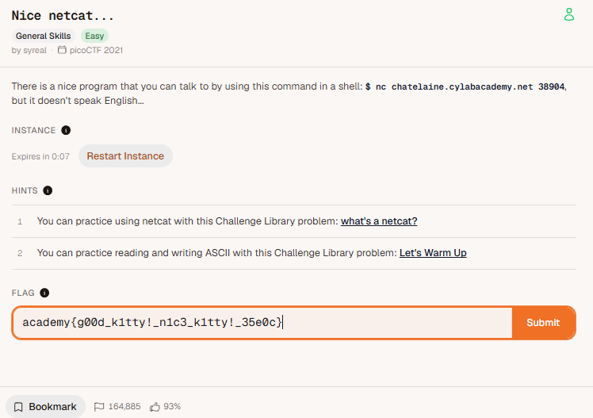

# 🚩 Challenge: [nice netcat]

## 📝 Challenge Description
> Paste the exact description text or hints provided by picoCTF here.
There is a nice program that you can talk to by using this command in a shell: $ nc chatelaine.cylabacademy.net 38904, but it doesn't speak English...

Instance
Expires in 0:05
Hints:
1. You can practice using netcat with this Challenge Library problem: what's a netcat?

2. You can practice reading and writing ASCII with this Challenge Library problem: Let's Warm Up

---

## 🚀 Exploitation / Solution Path
Detail your step-by-step breakdown to get the flag:
1. open netcat with session 
2. create a script to decode the numbers into ASCII
3. execute the script

### Automation Script (If applicable)
If you wrote a Python solve script using `pwntools` or `requests`, paste it here:

'''
from pwn import remote, log

# Connect to the remote challenge
host = 'chatelaine.cylabacademy.net' 
port = 38904 
conn = remote(host, port)

ascii_codes = []

log.info("Receiving data from server...")

try:
    while True:
        # Read a line from the server
        line = conn.recvline(timeout=2).decode().strip()
        
        # If timeout happens and line is empty, break
        if not line:
            continue
            
        # Check if the line is a digit
        if line.isdigit():
            ascii_codes.append(int(line))
        else:
            # Print non-digit lines (like instructions or flags) so you see them
            log.info(f"Server sent text: {line}")
            
except EOFError:
    log.info("Server closed the connection (EOF reached).")
finally:
    conn.close()

# Convert ASCII codes to characters if any were found
if ascii_codes:
    decoded = ''.join([chr(c) for c in ascii_codes])
    log.success(f"Decoded flag from ASCII: {decoded}")
else:
    log.warn("No ASCII numbers were collected. Check the server text logs above.")
'''
$ python3 script.py
[x] Opening connection to chatelaine.cylabacademy.net on p[/.......] Opening connection to chatelaine.cylabacademy.net on port Opening connection to chatelaine.cylabacademy.net on port Opening connection to chatelaine.cylabacademy.n[+] Opening connection to chatelaine.cylabacademy.net on port 38904: Done
[*] Receiving data from server...
[*] Server closed the connection (EOF reached).
[*] Closed connection to chatelaine.cylabacademy.net port 38904
[+] Decoded flag from ASCII: academy{g00d_k1tty!_n1c3_k1tty!_35e0c}
---

## 🏁 Flag
academy{g00d_k1tty!_n1c3_k1tty!_35e0c}

## 🧠 Key Takeaways & Lessons Learned
* What did you learn from this specific exploit?
netcat
scripting

* What commands or tools did you use for the first time?
pwntools
---