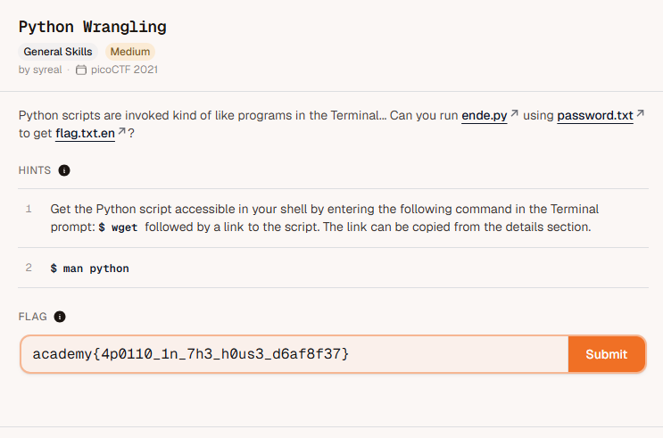

# 🚩 Challenge: [python wrangling]

## 📝 Challenge Description
> Paste the exact description text or hints provided by picoCTF here.

Python scripts are invoked kind of like programs in the Terminal... Can you run ende.py
 using password.txt
 to get flag.txt.en
?

Hints:
1. Get the Python script accessible in your shell by entering the following command in the Terminal prompt: $ wget followed by a link to the script. The link can be copied from the details section.

2. $ man python
---

### Code / Terminal Snippets
1. wget <ende.py link>
2. wget <password.txt link>
3. wget <flag.txt.en link>
4. cat password.txt | python3 ende.py -d flag.txt.en

Please enter the password:academy{4p0110_1n_7h3_h0us3_d6af8f37}

---

## 🚀 Exploitation / Solution Path
Detail your step-by-step breakdown to get the flag:
1. clone ende.py , password.txt and flag.txt.en into one location
2. enter this command cat password.txt | python3 ende.py -d flag.txt.en
3. flag will appear after entering the password like in automated cat password.txt.

---

## 🏁 Flag
academy{4p0110_1n_7h3_h0us3_d6af8f37}

## 🧠 Key Takeaways & Lessons Learned
* What did you learn from this specific exploit?
decrypting the flag from the encrypted files using password
* What commands or tools did you use for the first time?
wget
cat 
| 
-d
---
