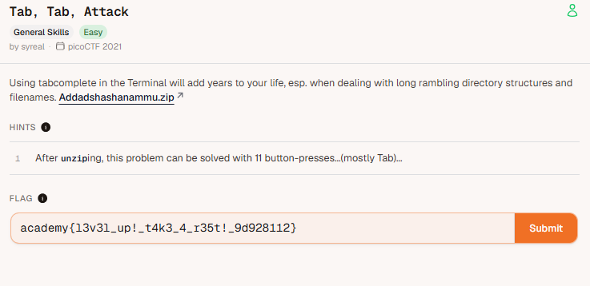

# 🚩 Challenge: [tab,tab,attack]

## 📝 Challenge Description
> Paste the exact description text or hints provided by picoCTF here.

Using tabcomplete in the Terminal will add years to your life, esp. when dealing with long rambling directory structures and filenames. Addadshashanammu.zip

Hints:
1. After unziping, this problem can be solved with 11 button-presses...(mostly Tab)...

---

## 🚀 Exploitation / Solution Path
Detail your step-by-step breakdown to get the flag:
1. unzip the zip file of Addadshashanammu.zip
2. cd Addadshashanammu 
3. ls
4. continue until you see a  fang-of-haynekhtnamet.c file
5. grep "academy"  fang-of-haynekhtnamet.c
6. the academy flag will appear

---

## 🏁 Flag
academy{l3v3l_up!_t4k3_4_r35t!_9d928112}

## 🧠 Key Takeaways & Lessons Learned
* What did you learn from this specific exploit?
changing directory, listing contents and finding patterns
* What commands or tools did you use for the first time?
cd 
ls
grep
---
